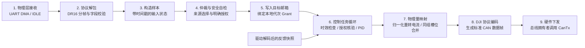

# 项目分层与代码导航

很多初学嵌入式的同学写代码时，习惯把“串口接收、协议解析、PID 计算、CAN 发送”全部堆在同一个 `main.c` 或中断回调函数里。这种写法在小玩具上尚可，但在复杂的 RoboMaster 机器人（如哨兵、云台、底盘）上会导致代码高度耦合、极其难以维护，一旦遇到偶发故障，调试起来如同大海捞针。

在阅读和编写本项目代码时，请先在脑海中建立起对这三个核心问题的清晰划分：
1. **数据怎么解释？**（协议编解码）：例如串口收到的 18 字节如何还原为遥控器摇杆数值？CAN 报文里的 8 字节如何转换为转子角度？——这属于**驱动与编解码层**。
2. **算法怎么算？**（闭环控制）：给定目标值与实际反馈，PID 应该输出多大的调节量？指令是否已过期失效？——这属于**通用核心算法层**。
3. **硬件怎么执行？**（平台与板级适配）：底层的临界区是用屏蔽中断实现还是用互斥锁？CAN 帧是通过 STM32 HAL 硬件邮箱发出还是主机模拟发送？——这属于**平台与板级组装层**。

系统全局设计约束请参考 [架构设计](../架构设计.md)，本文将带你把这些设计原则落实到具体的代码目录与工程结构中。

---

## 1. 核心分层职责划分

| 代码层级 | 源码目录位置 | 它的核心职责 | 它严禁负责的事情（非目标） |
|---|---|---|---|
| **通用核心层 (Core & Control)** | `include/ec/`（除 platform 外）、`src/` | 单调时钟、数据通道（邮箱/快照/事件队列）、代次授权门机制、通用 PID 与速度控制环、传感器与通信协议纯编解码（DJI/DR16/BMI088） | 严禁直接调用具体的芯片引脚、中断寄存器、FreeRTOS 任务创建 API；不包含具体机器人的战术策略 |
| **平台适配层 (Platform)** | `platform/`、`include/ec/platform/` | 将核心层抽象的锁机制映射为平台特定实现（如主机 `std::mutex`、F407 的 `PRIMASK` 关中断）；封装 HAL 时钟与 FreeRTOS `vTaskDelayUntil` 周期等待；实现 `CanTx` 硬件发送桥接 | 不负责具体的机械传动比换算、不负责比赛战术决策 |
| **板级组装层 (Boards)** | `boards/`（如 `boards/sentinel_f407/`） | 真实主控板（如 RoboMaster C 板）的晶振时钟树、GPIO 引脚映射、外设 DMA/中断接收分发、板载 RAM 诊断结构体维护 | 不包含上层自主比赛策略；不跨层篡改通用算法逻辑 |
| **机器人应用层 (App / Robots)** | 后续机型组装（当前 `examples/` 提供主机组装参考） | 来源仲裁（遥控器优先还是上位机优先）、显式安全使能事件处理、物理轴方向与减速比转换、机构安全保护策略 | 不得把特定硬件芯片寄存器细节塞回通用核心算法 |

> **分层调用原则**：
> - **单向依赖**：板级与应用层可以依赖核心层接口，但核心层代码绝对严禁反向包含平台或芯片特定的头文件（如禁止在 `src/control/` 中出现 `#include "stm32f4xx_hal.h"`）。
> - **模块不等于任务**：核心层提供的是算法和逻辑组件，而不是死板的一个模块绑定一个操作系统任务。在实际工程中，同一个 FreeRTOS 任务完全可以按确定的执行顺序串联执行多个算法组件。

---

## 2. 一条控制指令是如何在系统中流转的？

为了让你对整个系统的信号流向有一个直观的宏观感知，下面展示了一条标准速度控制指令从接收到执行的完整管道。
*(注：此处为架构设计的标准生命周期流向，当前 S1–S4 阶段的板级固件处于观察模式，暂未接通电机的最终硬件下发环节)*：

我们来逐环节拆解其设计背后的安全考量：
1. **物理接收与协议解包**：DMA 将原始字节流送入环形缓冲区，当检测到串口空闲中断（IDLE）时触发分帧。解析器严格验证 18 字节长度与各通道取值范围。**即使解包成功，也仅代表收到了一帧合法数据，绝不等于获得了电机转动许可**。
2. **时间打点与时效保护**：解析后的摇杆数据被打上本地单调时钟 `Tick`，封装为带有有效性标记的 `Sample<T>`。如果通信中断，时间戳将停止更新，下游可依靠时效检查（TTL）自动识别断链。
3. **应用仲裁与显式使能**：应用层对当前控制来源进行仲裁（例如当前是遥控器还是上位机 Orin 掌权？），并进行本地安全自检。只有在满足特定使能事件（如操作手明确拨动安全开关且通过自检）时，才向 `ExecutionGate` 申请有效的**代次授权令牌（Grant）**。
4. **绑定令牌写入邮箱**：控制目标与当前代次的 `Grant` 一并写入 `CommandMailbox`，最新值在所选锁策略保护下覆盖旧值。
5. **控制闭环运算**：底层的速度控制任务以固定周期（如 1 kHz）唤醒。控制环首先核查：**目标是否超时？反馈是否新鲜？指令携带的 Grant 是否匹配当前系统代次？** 只要任一条件不满足，控制器立即清空内部积分项并拒绝输出！只有全部条件合法，才执行 PID 计算。
6. **同组 CAN 槽位合并与发送**：DJI 电机在 CAN 总线上是 4 个一组共享同一个报文标识符的（例如 0x200 控制 1~4 号电调）。控制任务不能各自为战胡乱发送，必须由统一的总线拥有者把 4 个电机的控制量合并进同一个 8 字节 CAN 帧中，最后调用 `CanTx` 硬件接口安全下发。

---

## 3. 按开发需求查找代码速查表

当你想了解或修改系统某一处特性时，可以按本表快速定位源码文件：

| 你的开发需求 | 对应的核心源码入口 | 关联的单元测试 / 验证入口 |
|---|---|---|
| **查看或修改 PID 核心数学公式** | `include/ec/control/pid.hpp` `src/control/pid.cpp` | `tests/core_tests.cpp` (`pid_contracts`) |
| **了解速度闭环的时效检查与授权熔断机制** | `include/ec/control/velocity_loop.hpp` `src/control/velocity_loop.cpp` | `tests/sil_tests.cpp` (`velocity_contracts` 及 SIL 场景) |
| **修改 DJI 电机协议编解码与 ID 映射** | `include/ec/drivers/dji.hpp` `src/drivers/dji.cpp` | `tests/core_tests.cpp` (`dji_contracts`) |
| **修改 DR16 遥控接收与分帧逻辑** | `include/ec/drivers/dr16.hpp` | `tests/core_tests.cpp` (`dr16_contracts`) |
| **查阅线程安全通道与临界区保护机制** | `include/ec/channel.hpp` `include/ec/platform/host.hpp` | `tests/core_tests.cpp` (`gate_and_channels`) |
| **查阅 STM32F407 板级引脚分配与外设配置** | `boards/sentinel_f407/cubemx/` | `boards/sentinel_f407/cubemx/sentinel_s1/sentinel_s1.ioc` |
| **查阅 C 板底层中断与数据接收实现** | `boards/sentinel_f407/src/board_io.cpp` | `boards/sentinel_f407/check_firmware.py` |
| **编写或扩充离线单元测试用例** | `tests/core_tests.cpp` `tests/sil_tests.cpp` | `ctest --test-dir build/host` |

---

## 4. 关键开发规范与红线

在修改任何代码之前，请牢记以下工程纪律：
- **国际单位制 (SI Units)**：全系统强制统一采用国际标准单位制：
  - 长度与位移：米（`m`）
  - 角度与位姿：弧度（`rad`），禁止在算法内部混用角度度数（`deg`）
  - 线速度：米每秒（`m/s`）
  - 角速度：弧度每秒（`rad/s`），禁止直接使用电机转速 RPM 作为控制入参
- **零动态分配与无异常**：控制计算路径中严禁使用 `new`、`malloc` 或 C++ 异常处理。
- **显式所有权与引用传递**：组件之间通过明确的引用和生命周期组装，不使用模糊的全局变量，更不能越界隐式接管整车控制权。

了解了代码分层后，接下来推荐阅读 [开发与验证流程](开发与验证流程.md)，学习如何规范地编写代码并通过测试验证！( ´ ▽ ` )ﾉ
