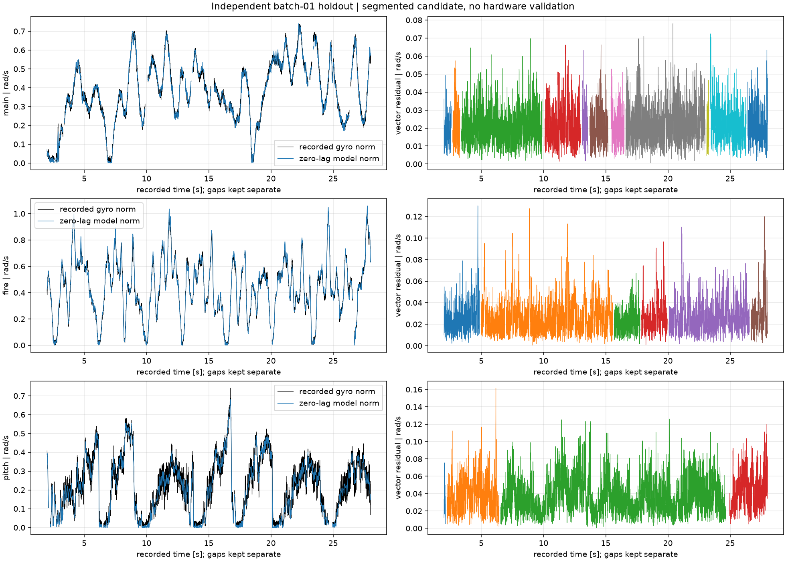

# 当前C板拟合与底盘/云台联调候选

当前检查点（2026-11-08）：板上为 `app-integration-site-candidate-20261108-clean`，BIN SHA256 `1676ec84…4cea73`，相对 §12.2 的 `…20261107-final` **仅恢复 `attitude.cpp` 的 `dx[3] = 0.0f`**，其余配置（量程 1.0/3.0/3.0、main 位置 42/3/0、速度归一化 0.060、11-03 几何）不变。已烧录、verify、独立回读逐字节一致，`reset run` 后 `CFSR=0x0`，角色审计通过。

§5.2 五步联调已于 2026-11-08 完成**带原始 wire 日志、安装照片和动作视频**的完整留档（§12.5.1）。量化结论：自旋 2.877 rad/s（达成率 96%）、纯自旋航向跨度 17.78°、恢复静止收敛至 7.41°；但**平移 51.87°、自旋＋平移 47.37°**，与姿态估计水平加速度污染方向一致，仍是最大未闭合项。§13 记录该污染的根因**未修复**，本轮只回滚到基线并补回归测试。下文 §1–11 保留旧板时期、旧几何及中间候选历史，**不用于推断此刻板上镜像**（新旧 main/fire 轴 X 分量符号相反）。

- 记录时间：2026-11-02 13:57:02 America/New_York（UTC−05:00）；2026-11-02 18:57:02 UTC。
- 任务目录：`<PROJECT_ROOT>/HANDOFF-sentinel-integration-agent-20261031`；工作源码在`source/`。
- 用户授权：用现有少量缺包实录分析拟合，采用保守输入比例，编译和离线验证；随后追加授权烧录本候选（见§7）。
- 本阶段完成：分段联合拟合、独立留出/原生回放、现场候选配置、ARM Release编译、镜像角色审计及主机49/49测试。
- 实车状态：编译阶段未打开串口、未运行机构。烧录阶段已完成APP候选写入/校验/回读，MCU停在暂停态，尚未启动运行；未打开串口、未使能电机。候选的`deployment_ready=false`表示尚无实车验收结论。

## 1. 文件入口

- [最终拟合候选](calibration/site-candidate-20261102-final.json)：输入SHA256、真实质量状态、全部分段窗口、轴向、偏置、参考姿态、前向假设和独立指标。
- [独立留出图](calibration/holdout-fit-20261102-final.png)：实测gyro范数与零时移模型、三维角速度残差。各缺口分段绘制，未补点。
- [原生回放汇总](calibration/replay-20261102-final/summary.json)及同目录CSV：原生RPM与居中导数诊断、5ms默认及10ms仅离线对照。
- [固件目录](firmware/app-integration-site-candidate-20261102/)：`sentinel_app.elf/.bin/.hex/.map`、`parameters-rom.json`和`SHA256SUMS.txt`。
- [源码差异清单](source-changes-20261102.json)：相对原始`SOURCE_BASELINE.json`的新增/修改/删除与哈希。

## 2. 数据与真实质量状态

第二批运动文件用于训练，第一批对应轴文件用于独立留出；文件及内容哈希均不同。

| 训练原文件 | 实收条数 | 缺失条数 | CRC/坏帧计数 |
|---|---:|---:|---:|
| stationary-20261102-03.sraw | 20943 | 10 | 3 |
| main-20261102-02.sraw | 26687 | 25 | 5 |
| fire-20261102-02.sraw | 26225 | 25 | 8 |
| pitch-20261102-02.sraw | 26587 | 26 | 7 |

原始文件和摘要均未改写，整份记录的`complete=false`保留。新增入口必须显式指定`--allow-wire-gaps`；先检查全源时间、CAN队列丢失、gyro FIFO及无效IMU，再按原始全局序号缺口切段。段边缘保留60ms缓冲，九点导数和±20ms时移查询不跨段。原严格标定入口和测试没有放宽。

最终采用训练27段、16433个gyro样本；独立留出21段、16547个gyro样本。过短片段及被采用的时间窗均在候选JSON中列出。

真实DM回读来自`captures/../logs/inspect-20261102-01.jsonl`：CAN2/反馈17、node1、PMAX12.5rad、VMAX30rad/s、TMAX10N·m、Gr10。MIT位置沿用原生输出轴角，不再次除Gr。早前助手构造的`mapping-current.synthetic-invalid.jsonl`已标明无效，本次不使用它。

对齐参考为`captures/alignment-20261102T180315Z.reference.json`，由用户确认main朝车头、fire朝main、pitch水平。采用同一4.43秒无缺口窗口；这是粗机械参考，未提供量角工具或光学测向精度。

## 3. 实际编译配置

`source/boards/sentinel_f407/include/board_app_integration_site.hpp`已回填，来源标记为`reference_converted`。

| 输入 | 满杆/固定指令比例 |
|---|---:|
| 平移 | 0.3 m/s |
| 普通转向 | 0.5 rad/s |
| 固定自旋 | 0.8 rad/s |
| main操纵 | 0.35 rad/s |
| fire操纵 | 0.3 rad/s |
| pitch操纵 | 0.2 rad/s |

上述值是用户授权的保守命令初值，不是现场证明的运动安全边界。PID、接线、传动、软件零偏、关节区间和协议输出范围未改。

坐标定义为对齐姿态处的`V=S`，`install=identity`；原始gyro偏置只扣一次。拟合得到的偏置为`[0.001689101, 0.001924209, 0.003755209]rad/s`。前向由静止加速度的上方向与pitch轴构造，使用“枪轴垂直pitch铰轴、正pitch抬头、枪轴水平”的粗机械假设，未冒称独立光学测向。

fire/pitch原生参考分别为1.7103885785/0.5575265126rad；减去本版软件零偏后，固件参考为`+0.036048549/-0.053788217rad`。硬件和软件零点均未修改。

优化得到的毫秒级位置时移尚未完成辨识，未应用到固件；固件采用明确测试过的零时移候选基线。原采样预算维持gyro50ms、关节20ms、外推5ms、gyro单步20ms。几何有效性门为原有0.01投影平方、0.02 heading gain、0.8m/s²加速度模长偏差，均为候选设计值，不是实测精度。

`parameters-rom.json`由主机程序实际包含本次C++部署配置后导出，已核对向量、偏置、参考换算、输入比例和时序预算。它是编译ROM配置快照，未读取MCU RAM，未声称全部运行参数已在板上生效。

## 4. 离线效果

下表使用固件采用的**零时移基线**；误差为三维角速度向量残差，不是枪口位置或姿态角误差。

| 独立留出轴 | 模型RMS rad/s | P95 rad/s | R² |
|---|---:|---:|---:|
| main | 0.02388 | 0.04089 | 0.99660 |
| fire | 0.03018 | 0.05418 | 0.99606 |
| pitch | 0.04267 | 0.07578 | 0.97422 |

训练与独立留出重复拟合的轴向差为main0.317°、fire0.088°、pitch0.273°。main/fire的运动模型与独立数据较一致；pitch残差更大，仍需要后续实车观察，不能用离线拟合替代带载控制结论。

原生`SentinelPerception`逐段回放中，默认5ms预算有效覆盖约79.86%/77.52%/76.28%；仅离线10ms对照约97.59%/97.26%/95.64%。采集记录经过降采样，fire/pitch间隔中位数约6ms，pitch存在更长间隔，故这些覆盖率不能用于证明真实快环性能或直接放宽固件预算。

RPM分支三轴原生重构RMS约0.02754/0.07482/0.05393rad/s；居中导数诊断约0.02386/0.03090/0.04311rad/s。居中导数使用未来样本，不能用于实时控制；RPM分支也未模拟当前APP两颗GM6020的五点因果编码器测速。回放以main编码角导数作为参考，仍假定底盘在人工采集时静止，缺少独立光学真值。



## 5. 编译与检查

- 主机：GNU C++16.2.1、Release；最终全量CTest **49/49通过**，其中分段分析11项测试通过。日志在`logs/host-build-site-20261102-final.log`和`logs/host-ctest-site-20261102.log`。
- 兼容性修复：已有协议测试的CRC破坏夹具在GCC16优化构建中报告`size-2`潜在越界；保留原断言，额外增加真实长度上下界的直接失败防护。未关闭`-Werror`、删除断言或跳过测试。
- ARM：GNU ARM16.2.0、CubeF4原包1.28.0加1.28.3补丁；Release编译通过，日志`logs/arm-site-build-20261102.log`。newlib的`_close/_lseek/_read/_write`空系统调用桩存在链接警告，角色审计仍通过。
- 镜像身份：`app-integration-site-candidate-20261102`，BIN **214824B**，RAM **103120B**。
- BIN SHA256：`b2a7e1a38f8fae7d7f5eeb61d937afd3e288b4e1f599bb6e9228ee5b636af34a`。
- ELF SHA256：`ed45dd9a844a3fc7929483a48045acd677b0c6901b0b354d798ad8addd62a28a`。
- 角色审计：`check_sentinel_app.py --chassis-gimbal-integration`通过；配置无synthetic/unknown来源设备槽。
- 保留原始PACKAGE、SOURCE_BASELINE、SHA256SUMS和交付镜像；新增候选在`results/firmware/`单独校验，没有把原始交付身份改成新镜像。

参考复跑命令（包根目录；输出必须使用新名字，工具拒绝覆盖）：

```text
<PROJECT_ROOT>/.venv/bin/python -B source/robots/sentinel/host/sentinel_segmented_calibrate.py results/captures/calibration-current.json --root . --reference results/captures/alignment-20261102T180315Z.reference.json --allow-wire-gaps --output results/calibration/recheck.json --native /tmp/sentinel-integration-host-20261102/ec_sentinel_replay --replay-dir results/calibration/recheck-replay --plot results/calibration/recheck.png
cmake --build source/build/site-app-20261102 --target sentinel_app --parallel 4
```

若`/tmp`原生回放程序已清理，先用当前源码重新构建`ec_sentinel_replay`。SDK和Python环境均沿用本机现有安装，未添加依赖。

## 6. 剩余事项

这次交付为**编译完成、未烧录、未实车验收的现场候选**。实际自旋/平移/瞄准效果、真实快环时效及长时间惯性漂移均未验证。明天若准备上车，先审阅本报告和ROM快照，取得新的烧录/运行授权，再按原任务顺序核对方向与普通运动，之后逐步进入自旋；本阶段没有启动任何后台采集或运动程序。

最终第二意见咨询再次超时，未收到可用顾问结论；上述检查均为本机实跑证据。父Git仓库原有工作未暂存、提交或改写；本交付包未被其跟踪，源差异按SOURCE_BASELINE记录。此前误放在`source/None`的仅含串口头部的记录已保留到`logs/preexisting-acm2-header-20261102.jsonl`。

## 7. 烧录结果（2026-11-03T00:17:21Z UTC）

- 探针：Horco CMSIS-DAP 序列号`332107148308`（USB`3-4.4`）。首次`init`报`CMSIS-DAP command CMD_INFO failed`，对`/dev/bus/usb/003/009`做单设备`USBDEVFS_RESET`后恢复，未改探针固件、未动其它探针、未复位整个集线器。
- 目标身份与台账一致：ID`0x101f6413`（低12位`0x413`）、Flash 1024KiB、UID`0x1a0039 0x30345106 0x30343537`。
- 写入：`sentinel_app.bin`214824B写入`0x08000000`，显式只擦sector0–5；`verify_image`通过；独立`dump_image`回读214824B。
- 回读SHA256 `b2a7e1a38f8fae7d7f5eeb61d937afd3e288b4e1f599bb6e9228ee5b636af34a`，与原始BIN逐字节一致（`cmp`无差异）。
- MCU当前处于**halted**：烧录脚本刻意未执行`reset run`，待现场确认承托、底盘防动、遥控停止位与硬断电条件后再启动。
- 日志与JSON：[app-flash-20261103T001721Z.log](firmware/app-flash-20261103T001721Z.log)、[app-flash-20261103T001721Z.json](firmware/app-flash-20261103T001721Z.json)。回读副本在`firmware/app-integration-site-candidate-20261102/readback.bin`。
- 边界：本次只证明镜像可写入并逐字节读回，不证明自旋/平移/瞄准效果、快环时效或长时间漂移。

### 启动自检（同一会话，随后已再次暂停）

为确认镜像能真正启动，执行过一次`reset halt`→`resume`约3秒→`halt`：PC从复位向量`0x08000bbc`推进到`0x0802b66c`（newlib `memset`，库初始化阶段），`CFSR=0x0`、`HFSR=0x0`，没有HardFault。之后再次`halt`，当前状态`halted`、PC`0x0802b662`。

这3秒内串口未打开、未发送任何目标、未申请运动权限，执行器没有收到使能目标；CAN侧只可能发撤输出/查询帧。仍应把这次短暂运行计入"已上电运行过"的记录，不要当作从未启动。

## 8. 遥控量程放大候选（2026-11-03T00:33Z UTC）

用户反馈原输入比例"太小了"。按约 2.5 倍放大遥控满杆命令量程，PID、电流/输出限幅、关节零偏、接线与协议输出范围全部未改：

| 字段 | 旧值 | 新值 |
|---|---|---|
| translation | 0.3 m/s | **0.8 m/s** |
| turn | 0.5 rad/s | **1.2 rad/s** |
| spin | 0.8 rad/s | **1.2 rad/s** |
| main_rate | 0.35 rad/s | **0.8 rad/s** |
| fire_rate | 0.3 rad/s | **0.7 rad/s** |
| pitch_rate | 0.2 rad/s | **0.5 rad/s** |

- 新镜像：`app-integration-site-candidate-20261103-scale`，BIN 214832 B，镜像角色审计 pass（installed_dji=9, installed_dm=1, synthetic=0, unknown=0）。
- **pitch 下限放宽**：用户现场反馈下限太紧动不起来，`-0.39253831` → **`-0.49253831` rad**（减 0.1），上限 `+0.37193870` 不变。BIN 内 `0x5e48` 处为新值，旧值已不存在。
- 最终 BIN SHA256 `069aa634ccdade1acc664ca06c0c6660d55bf810f3ea5e0ba48d0ab4a905c754`；ELF SHA256 `49499e5fd6df609bb7e42bab117bbebdd9eed9fd60079dfb9bef177344063f0c`。
- 直接从 BIN 的 rodata 复核过实际写入值：dead 0.05 / vx 0.8 / vy 0.8 / wz 1.2 / yaw 0.8 / pitch 0.5 / spin 1.2 / fire 0.7，friction 与 trigger 仍为 0（本角色不使用）。
- 主机 Release CTest **49/49 通过**（用项目 venv 的 scipy/pyserial）；ARM Release 编译通过。日志 `logs/host-ctest-site-scale-20261103.log`、`logs/arm-site-build-scale-20261103.log`。
- 固件目录：`firmware/app-integration-site-candidate-20261103-scale/`，旧候选 `...20261102/` 原样保留。

### 烧录尚未完成

本次尝试烧录新镜像时，探针 8308 的 DAP 通道已恢复（不再报 `CMD_INFO`），但 SWD 目标端持续报 `Error connecting DP: cannot read IDR`，100 kHz、500 kHz、connect-under-reset、`srst delay` 全部同样失败。当前现场只剩 8308 一支探针在线，当时判断为目标侧供电或 SWD 连线状态问题。此段已被下方"烧录结果"取代：经探针物理拔插后已成功写入并校验。

### 烧录结果（承接上节，2026-11-03T00:40Z UTC）

- 探针 8308 经用户物理拔插后恢复；此前一度报 `LIBUSB_ERROR_BUSY`，原因是一个被打断的 `openocd` 进程（PID 47114）仍占用接口 0，杀掉后恢复收发。
- 目标身份一致：`0x101f6413` / 1024 KiB / UID `0x1a0039 0x30345106 0x30343537`。
- 显式擦 sector 0–5，写 `0x08000000` 214832 B，`verify_image` 通过，独立回读 214832 B。
- 过程中出过一次操作失误：第一次烧录脚本里引用了不存在的 `image.bin`，sector 0–5 被擦空后才失败；同一会话内立即用正确文件名重写并校验通过，没有留下空片。
- 回读 SHA256 `069aa634ccdade1acc664ca06c0c6660d55bf810f3ea5e0ba48d0ab4a905c754`，与原始 BIN 逐字节一致。
- 从**回读数据**复核：pitch 下限 `-0.49253831`、上限 `0.37193870`，旧下限已不存在；量程 0.8/0.8/1.2、0.8/0.7/0.5 均在位；friction/trigger 仍为 0。
- 启动自检：`reset halt`→`resume` 2 秒→`halt`，PC 从 `0x08000bbc` 到 `0x08009a8a`（`prvIdleTask`，FreeRTOS 已调度），`CFSR=0x0`、`HFSR=0x0`，无 HardFault。当前 halted。
- 证据：`firmware/app-flash-scale-20261103T004000Z.log` / `.json`，回读副本 `firmware/app-integration-site-candidate-20261103-scale/readback-scale.bin`。

## 9. 小陀螺 5 倍提速并烧录（2026-11-03T00:50:54Z UTC）

用户要求把固定自旋从 1.2 rad/s 提到 5 倍。只改了 `board_app_integration_site.hpp` 的 `integration_spin_rad_s`，其值为 **6.0 rad/s**（约 57.3 转/分）。平移 0.8 m/s、普通转向 1.2 rad/s、main/fire/pitch 0.8/0.7/0.5 rad/s、pitch 下限 -0.49253831、PID、电流/输出限幅、关节零偏和协议范围均未改动。

- 新镜像 `app-integration-site-candidate-20261103-spin5x`，BIN 214832 B，ARM Release 角色审计 pass。
- BIN SHA256 `6d36e19b3c78c991310cfec7ad5f11686d9aa591ea44bca499c8913357bee337`；ELF SHA256 `7abf7d7a8f87fc381da4c8ea99292ffb165a569ad82def259fad2f5a675ecf56`。
- 与旧 `...20261103-scale` BIN 逐字节比对只有 9 个字节不同：映射表 `spin` 字段 4 字节（`0x2b7b8`），以及 `0x2bfc1` 起 5 字节常量池。其余逻辑未变。
- 编译期映射校验：`spin_wz_rad_s=6.0`，上拨杆进自旋档输出 6.0，右拨杆下档撤自旋，失联撤自旋，5 项相关主机测试 pass。
- 烧录：同一次 OpenOCD 连接内先核 ID `0x101f6413`、1024 KiB、完整 UID 三项；擦 sector 0–5，写 `0x08000000`，`verify_image` 通过，独立回读 214832 B。
- 回读 SHA256 与 BIN 完全一致，`cmp` 无差异；从回读数据确认 `spin=6.0`、`pitch_min=-0.49253830`。
- `openocd` 退出码 0，MCU 停在 **halted**，未执行 `resume`/`reset run`。
- 证据：`logs/app-flash-spin5x-20261103T005054Z.log`、`firmware/app-flash-spin5x-20261103T005054Z.json`，回读副本 `firmware/app-integration-site-candidate-20261103-spin5x/readback-spin5x.bin`。
- 边界：6.0 rad/s 是用户指定的命令值，不是实测最大转速；实际转速、稳向效果和带载表现均未验证。

## 10. 2026-11-03新云台参数迁入联调候选（离线完成，待现场）

- 输入：用户指定`<PROJECT_ROOT>/参数/云台参数表.csv`，SHA256 `d89a9cf7ba50e6515939714e7f7700c29eda2b11b13cf0b15ce9621ff4e38318`。原文件未改写，镜像目录保留输入快照。
- main：新表2.5A下原生速度增益0.05/0.002/0，位置28/2/0；联调保留3A输出策略，将速度增益按2.5/3换算为0.0416667/0.00166667/0，物理值0.125A/(rad/s)、0.005A/rad。
- fire：新表2.5A下原生速度增益0.16/3/0，位置32/0/0.1；联调换算为0.1333333/2.5/0，物理值0.400A/(rad/s)、7.5A/rad。
- pitch：MIT Kp=40、Kd=1，新增可选常数`gravity_ff_nm=+0.80 N·m`。校验有限、TMAX有效且绝对值不超过TMAX；缺省前馈为0。在现有执行授权、有效目标与反馈确认Enabled后写入MIT扭矩字段，停止/失联/失去目标沿用原disable路径。
- 保留：现场拟合几何、零位、pitch区间[-0.49253831,+0.37193870]rad、6rad/s自旋和其他输入比例。编译配置快照与旧几何按float32逐字段相等。
- 与独立云台候选的区别：联调保留3A饱和输出、位置外环不限速；未把新表旧坐标下的机械范围/命令带直接复制到本包。本轮未引入独立command_min/max字段；遥控目标仍按当前联调区间裁剪。前馈为编译配置，没有新增在线写参数接口。
- 验证：Release主机CTest 49/49通过。执行生命周期测试覆盖缺省0、+0.8、-0.8前馈，按真实MIT命令扭矩低12位解码核对，并检查未确认使能/撤目标/遥控失联时不发送MIT。配置测试覆盖NaN、Inf、正负越界拒绝及量程边界。ARM Release编译与integration角色审计通过。
- 镜像：[app-integration-site-candidate-20261103-retune](firmware/app-integration-site-candidate-20261103-retune/)，BIN215928B，SHA256 `a68f331064f9c54aeb3c4abe6f44327da98c9159dde7bb9be25885f8158dda8c`。ELF SHA256 `1303ef7c40a2dc0615f8492ed53fb71320d29759e84fbeabe910f6257b3883e8`。
- 同目录包含`parameters-rom.json`（实际包含当前C++部署配置导出，非MCU RAM读回）、输入CSV快照、`migration.json`（当前源码SHA、迁移决策和回退镜像）、`SHA256SUMS.txt`。验证日志：`logs/host-build-retune-20261103.log`、`logs/host-ctest-retune-20261103.log`、`logs/arm-site-retune-20261103.log`。
- 顾问：本轮方案与最终咨询均超时，未收到可用第二意见。上述验证为本机实际执行。
- 本轮未连接串口/SWD、未烧录、未发送运动或使能命令。下一步确认现场停止/固定承托/硬断电条件，核当前板上身份，再烧录、独立回读校验；先观察main在普通底盘运动下的目标与实际航向误差，再进入自旋。

## 11. 2026-11-03 C板更换后重采重拟合与联调（已完成）

### 11.1 换板事实

- 原 C 板 UID `0x1a0039/0x30345106/0x30343537`；新 C 板 UID `0x260050/0x30345109/0x30343537`。芯片同为 `0x101f6413`、Flash 1024 KiB。
- 换板后**旧几何作废**：新旧拟合结果 main/fire 轴的 X 分量符号相反（旧 `+0.098977/+0.111776`，新 `-0.097089624/-0.086802847`），gyro bias 的 Z 分量从 `+0.003539` 变为 `+0.000463`。这证实新板 IMU 安装方向与旧板不同，不能沿用任何旧标定值。
- 换板过程中出现的 SWD 间歇故障（`cannot read IDR`、`CMSIS-DAP command CMD_INFO failed`）经探针物理拔插与单设备 USBDEVFS_RESET 恢复；三支探针并行时非目标探针报错属正常。

### 11.2 采集（全部为换板后重录，每项两份）

| 项目 | 第1份 | 第2份 | 质量 |
|---|---|---|---|
| 对齐参考 | `aln-20261103T182144Z.sraw` | `aln2-20261103T182202Z.sraw` | 两份均 0 缺口 / 0 CRC / complete=true |
| 静止 | `stn2-01.sraw` | `stn2-02.sraw` | 均 0 缺口 / 0 CRC；gyro 31782 / 31843 样本 |
| main 运动 | `main3-01.sraw`（3 缺口/1 CRC） | `main3-02.sraw`（11 缺口/3 CRC） | 按缺口切段 |
| fire 运动 | `fire3-01.sraw`（0/0） | `fire3-02.sraw`（2 缺口/0 CRC） | 按缺口切段 |
| pitch 运动 | `pitch3-01.sraw`（0/0） | `pitch3-02.sraw`（0/0） | 完整 |

- 采集镜像 `capture-current-20261031-032021`（BIN 78480 B，SHA256 `a750840115064988ec676027fdc92cde4c6c0ac464d4e258ad07ac44535de809`），烧录到新板后擦 sector 0–4、写入、verify、独立回读，逐字节一致。
- 采集口径与上批一致：连续流 gyro/CAN 至多 250 Hz、accel 100 Hz；`.sraw` 与 `.summary.json` 成对保留。
- 原始 `.sraw` SHA256：aln `a60f3965…bb420`、aln2 `06c86a9c…8bc7b`、stn2-01 `ed5eb397…4f89b`、stn2-02 `d7a5b626…fc630`、main3-01 `4517aa8e…f1434`、main3-02 `66831aaf…7d90f`、fire3-01 `38bcea1c…5dc1bc`、fire3-02 `2396a894…c65fa`、pitch3-01 `4481ca04…7b6b5`、pitch3-02 `a8a8fb00…51e65`。

### 11.3 标定输入

- 清单 `captures/calibration-board2.json`，SHA256 `8c104e81101effe71b03e6f988fcd018ba3b9ce299f69af32155945e8fed00d4`。
- 对齐参考 `captures/aln-20261103T182144Z.reference.json`，SHA256 `10b7f4d4914967ebb9395793871d8178490ad7017882289d22a5b6bcbb3cfcb5`；选 1.0–5.0 s 内最长无缺口段、两端各 trim 30 ms，3574 条记录、0 缺口。
- mapping log 沿用 `logs/inspect-20261102-01.jsonl`：DM 寄存器（PMAX/VMAX/TMAX/node/Master/GR）属于电机本体，不随 C 板更换改变。工具校验 `ranges['master']==sources['pitch']['can_id']==17` 通过。

### 11.4 拟合结果

- 训练 4 段、留出 6 段；`main3-02` 的 part 0 因可用 gyro 样本不足被工具显式列入 `omitted_segments`，未静默丢弃。
- 零时移基线下的独立留出指标：

| 轴 | 训练 RMS | 训练 R² | **留出 RMS** | 留出 P95 | **留出 R²** |
|---|---:|---:|---:|---:|---:|
| main | 0.02447 | 0.99484 | **0.02233** | 0.03701 | **0.99453** |
| fire | 0.02497 | 0.99250 | **0.02391** | 0.04107 | **0.99172** |
| pitch | 0.03539 | 0.96671 | **0.03460** | 0.05961 | **0.96265** |

- 训练/留出重复拟合轴向差：main 0.1029°、fire 0.0221°、pitch 0.0441°。三轴单位化后两两正交（|点积| < 0.002），`forward` 模长 1.0。
- 相对旧板（11-03 16:33 那批）留出指标：main R² 0.99776→0.99453、fire 0.99420→0.99172、pitch 0.96788→0.96265。新板略低但仍属同一量级，差异与换板后重新装配的一致性相符。

### 11.5 最终几何（已写入 site 头并烧录）

```text
fire_axis   [-0.086802847,  0.031076549,  0.995740686]
pitch_axis  [ 0.014223269, -0.999415767,  0.031077689]
main_axis   [-0.097089624,  0.027570401,  0.994893702]
forward_V   [ 0.997511309,  0.016329022,  0.068589730]
gyro_bias_S [ 0.001770788, -0.000808838,  0.000463396] rad/s
fire_reference  -0.099708751 rad
pitch_reference -0.052262315 rad
```

- 参考姿态为 2026-11-03T18:21:44Z 对齐记录：main 朝车头、fire 朝 main、pitch 炮轴水平（操作员确认，粗机械参考，无量角精度）。
- `install` 为 identity，`V=S` 定义在该参考姿态；原始 sensor bias 在 install 前扣一次。
- `forward` 由用户确认的水平/朝前姿态、静止加速度上方向与正 pitch 抬头符号构造，采用枪轴垂直 pitch 铰轴的粗机械假设。
- 相对软件零的参考角换算基于现行零偏 main `1660*2π/8192`、fire `2183*2π/8192`、pitch `0.61131473`；**未修改任何关节软件零点或电调硬件零点**。

### 11.6 输入量程

- 底盘按轮面线速度 2.0 m/s 折算：translation **2.828427 m/s**、turn/spin **9.256184 rad/s**（约 530 °/s、88 rpm）。
- 依据 M3508 P19 输出轴空载约 49.1 rad/s（轮面 4.03 m/s）的物理上限取约一半，留出打滑与电流裕量。**这是命令量程，不是执行器限幅，也不是实测极限。**
- 云台三项保持 main 0.8 / fire 0.7 / pitch 0.5 rad/s。
- pitch 区间 `[-0.49253831, +0.37193870] rad`，MIT Kp 40 / Kd 1，`gravity_ff_nm = +0.80 N·m`。

### 11.7 固件与烧录

- 镜像 `app-integration-site-candidate-20261103-board2`，BIN 215928 B。
- BIN SHA256 `8d5080adcb13b1a93fa0bda441d8403a4b63bf2518ae43ae46bd18059a271c9f`；ELF SHA256 `86d83bc90101f6ec2b33441c3def0a87bca6c351648013ad499f7e96802ad81e`；HEX `9b2031a35e402fb0d4c4dda349a230aab966587d793f5426568ea8191d15bbd3`。
- 主机 Release CTest **49/49 通过**；ARM Release 编译通过，integration 角色审计 pass（installed_dji=9、installed_dm=1、synthetic=0、unknown=0）。
- 烧录：核 ID `0x101f6413`、1024 KiB、新板 UID 三项 → 擦 sector 0–5 → 写 `0x08000000` → `verify_image` 通过 → 独立回读 215928 B，**与 BIN 逐字节一致**。
- 从回读数据逐字段复核：新几何全部在位，旧板 main/fire 轴值与旧 gyro bias Z **均不存在**；量程 2.828427/9.256184/9.256184 在位；pitch 区间与前馈在位。
- 目录 `firmware/app-integration-site-candidate-20261103-board2/`（BIN/ELF/HEX/readback/SHA256SUMS/tcl/log）。

### 11.8 实车联调（文档 §5.2 五步）

| 步骤 | 内容 | 结果 |
|---|---|---|
| 1 | 坐标/方向核对 | **通过** |
| 2 | 普通底盘运动＋云台保持（main 惯性稳向） | **通过** |
| 3 | 原地自旋保持 | **通过** |
| 4 | 自旋中 fire/pitch 操纵 | **通过** |
| 5 | 加平移（全叠加） | **通过** |

- 结论来源：现场操作员逐步操作并确认，非本机自动化采集。本节不附 wire 日志或量化指标，联调期间未开启维护台记录。
- 五步均为定性通过，判据为：方向正确、main 平台保持朝向不随底盘转动、fire 保持相对角、pitch 保持水平无明显下垂、自旋与平移叠加时无失控。

### 11.9 已知边界与未闭合项

- 五步联调为**定性确认，无量化证据**：未记录 main 惯性角/速率、fire/pitch 角度/速率、实际轮速、`execute/reason` 与代次，也未保存 `app-*.wire.jsonl`。文档 §5.2 要求的这些指标缺项。
- **9.256184 rad/s 自旋（约 88 rpm）与 2.828427 m/s 平移未做长时间稳定性验证**：短时通过不等于持续负载下不打滑、不过热。
- 自旋＋平移叠加时的轮子饱和/打滑边界未测量；2.0 m/s 轮面速度是按 M3508 空载能力取半的经验值，非实测极限。
- `gravity_ff = +0.8 N·m` 仅验证了"放手不下垂"这一现象，未做不同 pitch 角下的前馈标定；该值在俯仰全程是否为常数未验证。
- 位置/速度时移沿用明确声明的零时移候选基线；本轮未辨识时移，`lags_identified=false`。
- pitch 区间为回报可用空间而非硬止点实测；越过配置区间仍按既有轴故障撤输出。
- 本轮采集期间 pitch 一直接受人工承托，采集固件不驱动、不使能、不置零。

## 12. 2026-11-07 最终候选：量程收敛、main增益整定与全量证据（已编译、已烧录、未实车量化验收）

### 12.1 本轮实际做了什么

- 修复 Jetson 侧调试链：源码编译 openocd 0.12.0 安装到 `/usr/local/bin`，补装 `libhidapi-dev`、`libjaylink-dev`；原 apt 0.11.0 对 Horco CMSIS-DAP 报 `SWD not supported`/`CMD_INFO failed`。
- 实测定清三支 DAP 的角色：8308=SWD 烧录、384=APP 业务口（921600）、353=APP 观察口（115200）。此前脚本把两路配反，是多次"串口无响应"的直接原因。
- 新增只读记录工具：`robots/sentinel/host/sentinel_record_all.py`（三页状态）、`sentinel_record_spin.py`、`sentinel_record_main_dual.py`（双口状态＋main 控制短窗，误差触发）、`tests/sentinel_record_main_dual_tests.py`（7 项离线回归）。
- 修复工具缺陷：观察口导出应答可晚于原 0.4 秒上限；停止命令误用 `run=0`；业务会话在观察口检查期间超时；高频短窗失败无阶段信息。
- main 增益整定：位置 Kp 60→42、速度 Kp 归一化 0.0416667→0.050→0.060，逐级单变量对照。
- 输入量程收敛：平移 2.828427→1.0 m/s、转向 9.256184→3.0 rad/s、固定自旋 6.0→3.0 rad/s。

### 12.2 最终固件（最终参数已固化并烧录，2026-11-07）

- 镜像 `app-integration-site-candidate-20261107-final`，`-DEC_FIRMWARE_ID=site-candidate-20261107-final`。
- BIN **215944 B**，SHA256 `7c88c30df3559d64aba466baaa78a877be1acc4b9f361e5df6a9ee5dd6c36cba`；ELF `6115d78d55203a88e6140faa0dca838a64829113780b01e6c105bce9738a871a`；HEX `06ece9db14de89ff73054310838d2b072633b958e2e5a87981c3dcc0ec51fe8e`。
- 目录 `results/firmware/app-integration-site-candidate-20261107-final/`（BIN/ELF/HEX/MAP/SHA256SUMS/configure.log/build-audit.log）。
- 主机 Release CTest **49/49 通过**；ARM Release 编译通过，integration 角色审计通过（installed_dji=9、installed_dm=1、synthetic=0、unknown=0）。
- BIN 逐字段复核：位置 Kp42/Ki3/Kd0、速度归一化 Kp0.060、fire 32/0/0.1、pitch MIT 40/1、前馈 0.8、量程 1.0/3.0/3.0、云台 0.8/0.7/0.5、几何 7 项全部在位；旧位置 60 与旧速度 0.0416667 已不在生效配置中（BIN 内 `60.0` 仅来自 RPM 换算常量 `tau/60`）。
- 烧录：核 ID `0x101f6413`、1024 KiB、UID `0x260050/0x30345109/0x30343537`，擦 sector 0–5，写 `0x08000000` 215944 B，`verify_image` 通过，独立回读 215944 B 与 BIN 逐字节一致（`cmp` 无差异）。随后 `reset run` 启动。
- 复位后回读参数：main 位置 42/3/0、速度归一化 0.060/0.001667/0、fire 32/0/0.1 与 0.133333/2.5/0、pitch MIT 40/1，**全部 `overridden=false`**，确认取自 ROM 而非 RAM 热改。
- 边界：只证明镜像可写入、可启动、参数已固化；实际稳向效果、峰值饱和与长时间温升仍未验证。

### 12.3 最终有效配置

| 类别 | 值 | 性质 |
|---|---|---|
| main 位置 PID | 42 / 3 / 0 | ROM 固件值（本轮固化）|
| main 速度 Kp（归一化） | 0.060（源 0.072 @2.5A 域，物理约 0.180 A/(rad/s)）| ROM 固件值 |
| main 速度 Ki / Kd | 归一化 0.0016667 / 0 | ROM 固件值 |
| fire 位置 PID | 32 / 0 / 0.1 | ROM 固件值 |
| fire 速度 PID（归一化） | 0.133333 / 2.5 / 0 | ROM 固件值 |
| pitch MIT | Kp 40 / Kd 1，gravity_ff +0.80 N·m | ROM 固件值 |
| 云台电流上限 | 3 A（fire 同；四轮 20 A） | ROM 固件值 |
| translation / turn / spin | 1.0 / 3.0 / 3.0 m/s、rad/s | ROM 固件值 |
| main / fire / pitch 操纵速率 | 0.8 / 0.7 / 0.5 rad/s | ROM 固件值 |
| 关节零位与区间 | main 1660·2π/8192；fire 2183·2π/8192、[-1.18116523,+0.28838839]；pitch 0.61131473、[-0.49253831,+0.37193870] | 未改 |
| 几何 | 11-03 拟合三轴、forward、gyro bias、fire/pitch reference | 未改 |

- 归一化速度增益与 GUI/物理单位关系：轴侧电流上限 3A 下物理增益 = 归一化值 × 3。
- 与交付原始基线差异：输入比例由 0 改为上表数值；`integration_serial_geometry` 由空改为本次拟合几何；main/fire 速度与位置增益按云台参数表迁移并现场整定；其余接线、方向、传动、协议范围未改。

### 12.4 采集与拟合（11-03 新板）

- 输入清单 `captures/calibration-board2.json`，SHA256 `8c104e81101effe71b03e6f988fcd018ba3b9ce299f69af32155945e8fed00d4`。
- 对齐参考 `captures/aln-20261103T182144Z.reference.json`，SHA256 `10b7f4d4914967ebb9395793871d8178490ad7017882289d22a5b6bcbb3cfcb5`。
- 独立留出（零时移）main 0.02233 rad/s / R² 0.99453，fire 0.02391 / 0.99172，pitch 0.03460 / 0.96265；训练-留出轴向重复性 main 0.1029°、fire 0.0221°、pitch 0.0441°。
- **本轮补跑原生 C++ 回放**（此前该字段缺失）：候选 `results/calibration/site-candidate-board2-20261107.json`，回放程序 SHA256 `3bfe65e7b8a3314008f97d52201696f2a077349546165d255e58a011d2704a30`，逐段明细 CSV 在 `results/calibration/replay-20261107/`，留出图 `results/calibration/holdout-fit-20261107.png`。
- 几何数值与 11-03 原候选逐项一致（未因补跑而变化）。

| 轴 | 原生零时移 5ms 有效覆盖 | 5ms RMS rad/s | 10ms 有效覆盖 | 派生诊断 5ms RMS |
|---|---:|---:|---:|---:|
| main | 77.29% | 0.02494 | 96.67% | 0.02258 |
| fire | 72.30% | 0.08129 | 91.62% | 0.02388 |
| pitch | 78.29% | 0.04425 | 97.42% | 0.03455 |

- 回放要点：逐段重置；原始 RPM 分支不复现 APP 的五点因果编码器测速；派生诊断使用未来样本，**不能用于实时控制**；不给出航向或实车结论。

### 12.5 联调证据

- §5.2 五步（方向核对、底盘运动＋云台保持、原地自旋、自旋中 fire/pitch、加平移）已由操作员逐步现场确认可用；**为定性确认，无逐项量化留档**。
- 自旋＋平移工况下 main 存在可测的衰减振铃，见 12.6。
- 原始日志位置：

| 文件 | 内容 | 是否有效 |
|---|---|---|
| `results/logs/app-all-20261107T053559Z.jsonl` | Kp60 转向扰动，600 组 | 含一次事后分析的样本，注意场景不同 |
| `results/logs/app-all-20261107T060413Z.jsonl` | Kp60 自旋＋平移自由操作 | 有效 |
| `results/logs/main-dual-20261107T163045Z/` | Kp60 双口，600 组状态＋4 份短窗 | 短窗仅覆盖 0.33% |
| `results/logs/main-dual-20261107T165938Z/` | Kp60 双口，1198 组；短窗 12 次失败 | 高频失败；1 份事后从冻结缓存恢复 |
| `results/logs/app-all-20261107T175309Z.jsonl` | 位置42/速度0.0416667，4 次脉冲 | 有效 |
| `results/logs/app-all-20261107T181311Z.jsonl` | 同上重复，17 次脉冲 | 有效 |
| `results/logs/app-all-20261107T184531Z.jsonl` | 位置42/速度0.050，5 次脉冲 | 有效 |
| `results/logs/app-all-20261107T185506Z.jsonl` | 位置42/速度0.060，11 次脉冲 | 有效 |

- 每轮对应的 `*.analysis.md` 已与原始数据同目录保存。
- 高频控制短窗在运动期间未能稳定采集，因此没有覆盖误差峰值时的输出/限流记录。

#### 12.5.1 2026-11-08 五步联调完整留档（含照片与视频）

本节补上此前"定性确认、无量化证据"的缺口。数据、照片、视频均已归档。

**固件**：`app-integration-site-candidate-20261108-clean`
- BIN SHA256 `1676ec844c784c1a4125bf2f44db33ac9b3ef28e5b3c7509b1f8abfa7b4cea73`，215928 B
- 相对 §12.2 的 `…20261107-final`，**唯一差异是 `attitude.cpp` 恢复 `dx[3] = 0.0f`**（回归 `SOURCE_BASELINE` `d4602f1f…`）
- 烧录：UID `0x260050/0x30345109/0x30343537`，擦 sector 0–5，verify 通过，独立回读逐字节一致，`reset run` 后 `CFSR=0x0`
- 角色审计：`installed_dji=9, installed_dm=1, synthetic=0, unknown=0`

**原始证据**：

| 位置 | 内容 | 校验 |
|---|---|---|
| `results/logs/app-20261108T121953/app-1794111645173826196.wire.jsonl` | 原生 `sentinel_console.py` 原始帧日志，63070 条，37 MB | SHA256 `86845760…3033` |
| `results/logs/app-20261108T121953/README.md` | 采集条件、日志结构、动作区间 | — |
| `results/media/app-20261108/` | 6 张安装照片 + 1 段动作视频 | 见同目录 `SHA256SUMS.txt` |

**动作区间**（按 `wheel_odom.twist` 自动划分，非操作员逐段标记）：

| 区间 | 运动 | 实测均值 |
|---|---|---|
| 0–45 s | 静止 | \|v\|≈0.011 m/s |
| 45–90 s | 平移 | \|v\| 0.15→0.48 m/s |
| 90–120 s | 减速归零 | — |
| 135–255 s | 纯自旋 | wz ≈ 2.877 rad/s（164.8°/s） |
| 255–330 s | 自旋＋平移 | wz 2.88 + \|v\| 0.29→0.48 m/s |
| 330–420 s | 撤平移，保持自旋 | — |
| 420 s 后 | 全零 | — |

**main 稳向指标**（航向已解卷绕；`main_platform.validity` 全段 100% valid）：

| 阶段 | 航向跨度 | 漂移 |
|---|---:|---:|
| 静止基线 | 0.38° | −0.29° |
| 底盘平移 | **51.87°** | +21.69° |
| 纯自旋 | 17.78° | +12.31° |
| 自旋＋平移 | **47.37°** | +10.12° |
| 恢复静止 | 7.41° | +1.93° |

**判读**：
- 自旋转速达成 2.877/3.0 ≈ 96%，与配置吻合。
- 纯自旋仅 17.78° 跨度，恢复静止收敛到 7.41°，**说明自旋工况与收敛能力可用**。
- 平移与自旋＋平移两项均约 47–52°，是**本轮最大的量化缺陷**，且与 §13.1 记录的姿态估计水平加速度污染方向一致——平移提供水平加速度，纯自旋不提供，两者相差近 3 倍。
- 该指标含估计器误差，**不能单独判为机械摆动**；无独立光学真值。

**仍缺**：`sentinel_raw.py` control 短窗（§5.2 可选的 DJI 瞬态补充）未采集；高频输出/限流记录仍缺。

### 12.6 发现的问题与改动

1. **Jetson 串口不能收发根因**：非接线故障。业务口/观察口角色配反；观察口应答延迟超过客户端 0.4 秒上限；停止命令误用 `run=0` 导致 `error=2`；业务会话在观察口探测期间超 200ms 失效。已全部修正并有离线回归测试。
2. **DAP 通道间歇失效**：`CMD_INFO failed` 只能物理拔插恢复，USB 软复位无效。已记录为已知现场约束。
3. **main 自旋＋加减速振铃**：位置 Kp 60 时回中后 3.6–7.7 秒才基本收敛；降到 42 后峰值 23.34°→15.13°，恢复约 2.0–2.9 秒。速度 Kp 0.0416667→0.050 带来明显改善；0.060 与 0.050 收益接近，未观察到进一步缩短。
4. **姿态估计存在独立缺陷（本节结论已被 §13.1 更正）**：离线最小复现显示，真实航向不动时仅加入 2 m/s² 水平加速度即可产生约 10.37° 假航向；关闭加速度校正后为 0°。**原文"生产代码未改"不成立**：当时 `attitude.cpp` 已删除 `dx[3] = 0.0f;`，同工况实测为 18.18°。已于 §13.2 回滚并补回归测试，缺陷本身仍未修复。
5. **高频短窗缓存限制**：512 条共享缓存，500ms 请求约 211ms 实际覆盖；导出期间无法并发采集第二个窗口。

### 12.7 优化与建议

- 已实现：DAP 角色与串口时序修复、误差触发式短窗采集（默认 5° 阈值）、main 位置/速度增益整定、量程收敛、原生回放补齐。
- 未实现建议：
  1. 修复姿态估计对水平加速度的航向污染（优先级最高，已有离线复现入口 `source/.tmp/yaw-review/`）；需先修算法再评估是否继续调 PID。**§13.2 只做了回滚与回归测试，根因未修；§13.3 记录了 Euler-lock 不是完整解。**
  2. 高频采集需覆盖误差峰值；当前单缓冲方案在导出期间存在盲区。**§13.4 记录：预触发方案实测不可行（512 条仅覆盖 ~160 ms，触发后无样本），已回滚；受 RAM 容量约束，本条维持为未实现建议。**
  3. ~~补齐安装照片与动作视频~~ **已完成（2026-11-08），见 §12.5.1 与 `results/media/app-20261108/`。**
  4. 长时间温升、持续自旋、打滑边界与 pitch 前馈全行程标定尚未验证。

### 12.8 本轮边界

- 最终固件已完成编译、审计、49/49主机测试、烧录、校验与回读，并在复位后回读确认ROM参数生效；实际稳向性能与峰值限流仍未验证。
- 上述联调结论来自操作员现场反馈与普通 10Hz 状态记录，不是高频闭环验收。

## 13. 2026-11-07 补充：姿态估计回滚、预触发缓冲与时移评估（离线，未烧录）

本节只做离线改动与验证；未连接串口/探针、未烧录、未运行机构。§12.2 记录上次烧录了 `site-candidate-20261107-final`；复查未读取现场板，不能确认其当前镜像。

### 13.1 发现：生产源码曾偏离基线且与报告不符

- §12.6-4 与 `docs/handoffs/2026-11-06_gimbal-main-yaw-sway.md` 都写"生产代码未改"。实际 `source/src/estimation/attitude.cpp` 相对 `SOURCE_BASELINE`（SHA256 `d4602f1f…331ec`）**删除了 `correct()` 中的 `dx[3] = 0.0f;`**，内容等同于 `.tmp/yaw-review/attitude_full_update.cpp` 这个标注为 "Diagnostic variant" 的实验版。
- 用未修改的 `.tmp/yaw-review/minimal_accel.cpp` 分别链接两版，同输入（2 m/s² 水平旋转加速度，角频率 6 rad/s，约 0.955 Hz，yaw 0.7 rad）：

| 版本 | 假航向峰值 |
|---|---:|
| 基线 `dx[3]=0`（SOURCE_BASELINE） | 10.371950° |
| 偏离后的生产源码（提交时） | **18.184715°** |
| Euler-yaw 锁定变体（`review-IZgdRZ/`） | 0.126061° |
| 关闭加速度校正（诊断对照） | 0° |

- 全参数扫描（amp∈{2,3,3.9}、yaw∈{0,0.7,1.57,3.0}、角频率∈{0,0.1,1,6} rad/s，共 48 点）：偏离版本在 22 个点变差、10 个点变好；均值 8.53°→13.57°，最大 53.86°→55.76°。这是合成工况比较，没有证明实车加速度频段或各因素贡献。
- 复查时用原 ARM 编译参数重编两版，并将归档 ELF 的 `AttitudeEstimator::correct` 与删除该行版本比较：函数大小均为 5842 B，除 9 处重定位外字节一致，9 处调用目标均匹配。归档 BIN 与独立回读 BIN 的 SHA256 均为 `7c88c30d…51fe8e`，因此可确认该次烧录并回读的镜像包含删除该行版本；复查未连接现场板。
- 原有 `attitude_tests` 对该变体通过；这一测试集未拦住该回归。

### 13.2 处理：回滚到基线并补回归测试

- `attitude.cpp` 已恢复 `dx[3] = 0.0f;`，文件 SHA256 回到 `d4602f1f…331ec`，与 `SOURCE_BASELINE` 逐字节一致。
- 新增两条契约（`tests/attitude_tests.cpp`）：
  - `yaw_not_polluted_by_accel_contracts`：yaw=0 静止 + 2 m/s²、角频率 6 rad/s 的水平加速度，峰值航向误差必须 < 1°。独立变异验证中回滚版通过，删除该行的版本失败（exit 3）；该测试不覆盖 yaw=0.7 的完整平台航向工况。
  - `yaw_under_acceleration_documented`：记录已知缺陷量级（静态横向加速度约 0.8°，上界 2°），防止把"未修复"当成"已修复"。
- 主机全量 CTest **49/49 通过**；`ec_attitude_tests`、`ec_sentinel_integration_tests` 单独复跑通过。

### 13.3 仍未修复：航向污染的根因

- Euler-lock 变体在角频率 6 rad/s 工况为 0.126°，但静态横向加速度下仍有 1.83°（amp 2）/ 3.55°（amp 3）；这些对应 yaw=0.7 的基线为 1.51°/2.98°。它不是完整解，因此本轮没有采用。
- `correct_accel()` 用加速度模长与重力模长之差筛选，水平线加速度仍可进入重力观测并污染估计；如何可靠区分线加速度与姿态变化仍需单独设计和验证。
- 本轮只回滚，**不声称该缺陷已修复**。§12.7-1 的优先级不变。

### 13.4 高频短窗预触发尝试：已回滚，恢复基线行为

- 曾尝试给 `Recorder` 增加 `arm()/fire()` 预触发环形缓冲（`op=4/5`）并接入双口记录工具。经实测与独立复查，该方案不成立，已**全部回滚**到交接基线行为。
- 回滚依据（实测）：control profile 下 gyro 1 kHz + CAN stream4 1 kHz + control trace 1 kHz + accel 200 Hz，合计约 3.2 k 条/秒；512 条容量仅覆盖约 **160 ms**。等待触发期间缓冲即被填满，`fire()` 后 `state_=full`，**触发之后零条样本**——与"覆盖误差峰值两侧"的目标相反。
- 原始任务文档亦不支持该设计：`哨兵只读采集与人工标定.md` 规定"512 条为有界环形队列，**队列满丢新条**，不阻塞采样、**不假装补齐**"；`Agent-底盘云台联调.md` §5.2 明确"短窗**不能替代**长时间多轴高频记录"。
- 回滚后状态（与原始 ZIP 逐字节一致）：`raw_record.{hpp,cpp}`、`board_raw.cpp`、`sentinel_raw.py`、`capture_tests.cpp` 均恢复基线哈希；`sentinel_record_main_dual.py` 与 `sentinel_record_main_dual_tests.py` 为会话新增文件，已去掉预触发分支，恢复 op=1 单短窗语义（7 项离线测试通过）。
- 结论：**高频短窗是已知容量限制下的片段采集，不是待修复缺陷**。真正覆盖误差峰值需要扩缓冲（RAM 不足）或降采样（会丢 CAN 反馈流），均超出本轮范围。

### 13.5 时移辨识评估：现有证据不足，维持零时移候选

- 候选 `results/calibration/site-candidate-board2-20261107.json` 的联合拟合给出位置时移 main 3.689 ms、fire 0.992 ms、pitch 3.426 ms（搜界 ±20 ms）。
- 与同候选的零时移对照比较（`fits.zero_lag` vs `fits.position`，RMS 为三维角速度残差）：

| 轴 | 数据 | 零时移 RMS | 带时移 RMS | 相对改善 |
|---|---|---:|---:|---:|
| main | train | 0.024468 | 0.025131 | **−2.71%** |
| main | holdout | 0.022333 | 0.022236 | +0.43% |
| fire | train | 0.024972 | 0.024917 | +0.22% |
| fire | holdout | 0.023907 | 0.023835 | +0.30% |
| pitch | train | 0.035394 | 0.034759 | +1.79% |
| pitch | holdout | 0.034596 | 0.034065 | +1.53% |

- 上表只是已有候选的 RMS 对照；联合拟合优化的是 `soft_l1` 损失，不能由 RMS 改善小或个别训练 RMS 变差，断言时移只是在拟合噪声。
- 当前没有完成独立时序真值或充分的不确定性评估，故保留 `lags_identified=false`、不将拟合时移写入固件。是否可从现有数据辨识、是否必须新增外部真值，仍需进一步验证。
- 该结论只更新了记录，`sentinel_segmented_calibrate.py` 的行为未改。

### 13.6 本节验收

| 项 | 结果 |
|---|---|
| `attitude.cpp` 回到 SOURCE_BASELINE 哈希 | 通过（`d4602f1f…331ec`） |
| 新增姿态回归测试能拦住偏离版本 | 通过（偏离版 exit 3，回滚版 exit 0） |
| 回滚后隔离主机 Release 全量 CTest | **49/49 通过**（项目 `.venv`，15.57 s） |
| 回滚后双口记录器离线测试 | **7/7 通过**（删除 4 项预触发用例） |
| 记录仪/板级/主机采集与原始 ZIP 逐字节比对 | 5 个基线文件全部一致 |
| 预触发 | 已回滚；实测证明方案不可行，不作为待修缺陷 |
| 时移评估 | 证据不足以确认硬件时移，维持零时移候选 |

### 13.7 本节边界与未完成

- 上述源码改动**均未烧录**；§12.2 记录的烧录与回读镜像已核实含 13.1 描述的偏离版本。复查未连接现场板，当前板上镜像需现场重新核验；任何烧录须另行授权。
- Euler-lock 变体只在离线对照中出现，未进入生产源码。
- 预触发已整体回滚，板上与源码均回到基线 op=1 单短窗语义。
- 安装照片与动作视频**已于 2026-11-08 补齐**（`results/media/app-20261108/`）。仍需现场条件的项：长时间温升、持续自旋、打滑边界、pitch 前馈全行程标定。
- 本轮隔离构建先误选系统 Python，6 项因缺少 `serial`/`scipy` 失败；重新配置为项目 `.venv/bin/python` 后 49/49 通过。ARM newlib 仍报告 `_close/_lseek/_read/_write` 桩警告。
- 本轮 ARM 临时候选 BIN SHA256 `bed0083cb878febeda485b546191879473256687800bab039e1ec1a9051fdd10`，只在当前会话临时构建目录；未替换归档固件、未烧录。
